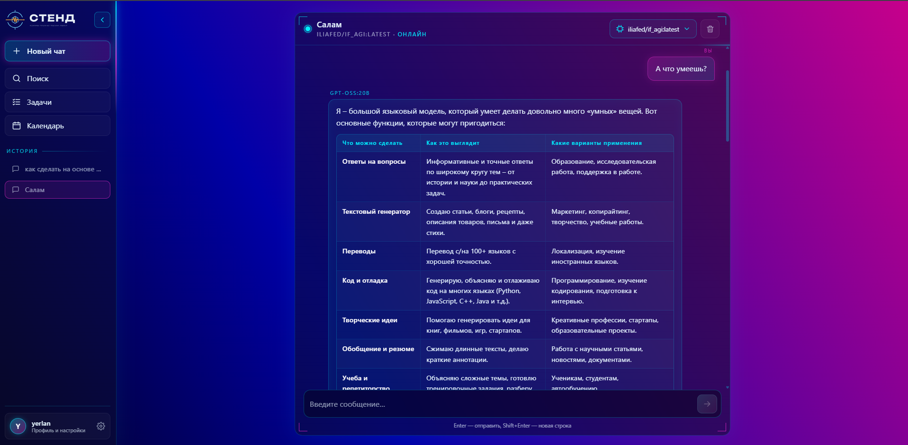

# СТЕНД — локальный AI-чат

Веб-интерфейс для общения с языковыми моделями через любой OpenAI-совместимый API: Ollama, LM Studio, vLLM, OpenAI, OpenRouter. Тёмная sci-fi тема, история чатов, поиск, учёт расхода токенов по пользователям.



## Возможности

- **Чат с моделями.** Модель выбирается из списка, который приходит с подключённых серверов. В запрос уходит история диалога: модель помнит контекст.
- **Markdown в ответах.** Таблицы, код с подсветкой синтаксиса и кнопкой «Копировать», списки, цитаты. HTML от модели очищается через DOMPurify перед показом.
- **История и поиск.** Чаты сохраняются в базе и показываются в сайдбаре. Поиск работает по названиям и тексту сообщений прямо во время ввода.
- **Несколько API.** Сервер по умолчанию задаётся в `.env`. Каждый пользователь может подключить свои серверы в профиле.
- **Учёт токенов.** Входные и выходные токены записываются по каждому запросу. Сводка в профиле (сегодня, месяц, всего, по моделям) и отчёт с фильтрами в админке.
- **Профиль.** Аватар, личные данные, настройки, выход.
- **Навигация без перезагрузки** (htmx) с анимацией переходов. Сайдбар сворачивается, есть мобильная версия.
- **Регистрация и вход.** Гость видит только эти формы, на фоне анимированный перцептрон с разрядами.

## Стек

- Python 3.12, Django 6.1, SQLite
- htmx через [django-htmx](https://github.com/adamchainz/django-htmx)
- Bootstrap 5.3, marked, DOMPurify, highlight.js: все библиотеки лежат локально в `main/static/main/vendor/`, CDN не нужен
- Клиент LLM написан на стандартной библиотеке Python (`urllib`), без дополнительных зависимостей

## Быстрый старт

```bash
python -m venv venv
venv\Scripts\activate            # Linux/macOS: source venv/bin/activate
pip install -r requirements.txt

copy .env.example .env           # Linux/macOS: cp .env.example .env
# заполните .env (см. ниже)

python manage.py migrate
python manage.py createsuperuser
python manage.py runserver
```

Откройте http://127.0.0.1:8000, зарегистрируйтесь или войдите под созданным пользователем.

Чтобы сайт открывался с других устройств в сети, добавьте IP машины в `ALLOWED_HOSTS` и запустите сервер так:

```bash
python manage.py runserver 0.0.0.0:8000
```

## Настройки `.env`

| Переменная | Пример | Описание |
|---|---|---|
| `SECRET_KEY` | `django-insecure-…` | Секретный ключ Django |
| `DEBUG` | `True` | Режим отладки. В продакшене `False` |
| `ALLOWED_HOSTS` | `localhost,127.0.0.1,192.168.1.2` | Разрешённые хосты через запятую |
| `LLM_NAME` | `STEND Server` | Название сервера по умолчанию в меню моделей |
| `LLM_URL` | `http://localhost:11434/v1` | Базовый URL OpenAI-совместимого API. Пусто — сервер по умолчанию отключён |
| `LLM_API_KEY` | | Ключ API. Для локальных серверов обычно не нужен |

## Подключение моделей

Подойдёт любой сервер, который поддерживает `GET /models` и `POST /chat/completions` в формате OpenAI. Указывается **базовый URL**, вместе с `/v1`:

| Сервер | Базовый URL |
|---|---|
| Ollama | `http://localhost:11434/v1` |
| LM Studio | `http://localhost:1234/v1` |
| OpenAI | `https://api.openai.com/v1` |
| OpenRouter | `https://openrouter.ai/api/v1` |

Есть два способа:
- **Для всех пользователей** — переменные `LLM_URL` / `LLM_API_KEY` в `.env`.
- **Лично для себя** — Профиль → вкладка «API» → «Добавить». Кнопка «Проверить» показывает, доступен ли сервер и сколько на нём моделей.

Список моделей кешируется на 5 минут, ответ модели ждём до 3 минут.

## Учёт токенов

Каждый успешный ответ модели создаёт запись `TokenUsage`: пользователь, чат, модель, API, входные и выходные токены.

- Значения берутся из поля `usage` ответа API. Если сервер его не вернул, токены оцениваются приблизительно (~4 символа на токен), а запись помечается как оценка.
- Записи сохраняются при удалении чата, поэтому расход не обнуляется.
- **Где смотреть:**
  - под каждым ответом в чате (`↑вход ↓выход`);
  - Профиль → «Расход»;
  - Админка → «Расход токенов», с итогами по выбранным фильтрам.

## Структура проекта

```
project/
├── project/                 # настройки Django (settings, urls)
├── main/
│   ├── ai.py                # клиент OpenAI-совместимого API, сервер по умолчанию
│   ├── models.py            # Profile, Setting, Api, Chat, Message, TokenUsage
│   ├── views.py             # страницы, отправка сообщений, профиль, API
│   ├── forms.py
│   ├── context_processors.py  # история чатов для сайдбара
│   ├── signals.py           # профиль и настройки создаются вместе с пользователем
│   ├── templates/
│   │   ├── base.html        # общий каркас: сайдбар, модалка профиля
│   │   └── main/            # страницы: chat, search, profile, login, register…
│   └── static/main/
│       ├── css/             # style-dark.css (общие стили), chat.css
│       ├── js/              # script.js, chat.js, neural-bg.js
│       └── vendor/          # bootstrap, marked, dompurify, highlight.js
├── .env.example
└── requirements.txt
```

Страницы рендерятся целиком при обычном запросе и только блоком контента при запросе от htmx (`render_page` в `views.py`, блоки `` в шаблонах). У новой страницы должны быть два блока: `` и ``.

## Безопасность

Проект рассчитан на локальное использование. Перед публикацией в интернете:

- задайте `DEBUG=False`, новый `SECRET_KEY` и настройте раздачу статики и медиа;
- ключи API пользователей хранятся в базе открытым текстом — их стоит шифровать;
- сервер обращается к URL, который указал пользователь. Это нужно для локальных моделей, но на публичном сервере открывает доступ к внутренней сети, поэтому такие адреса нужно ограничить.
